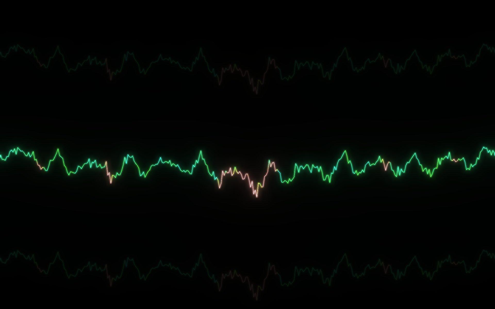
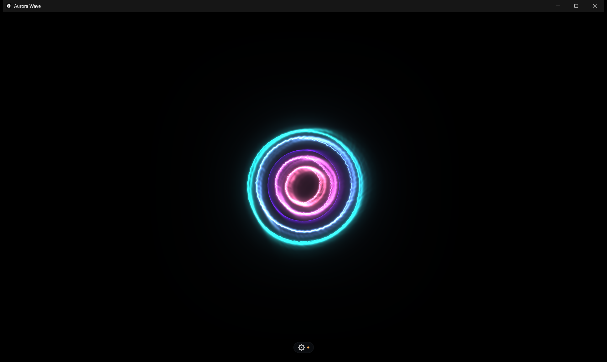
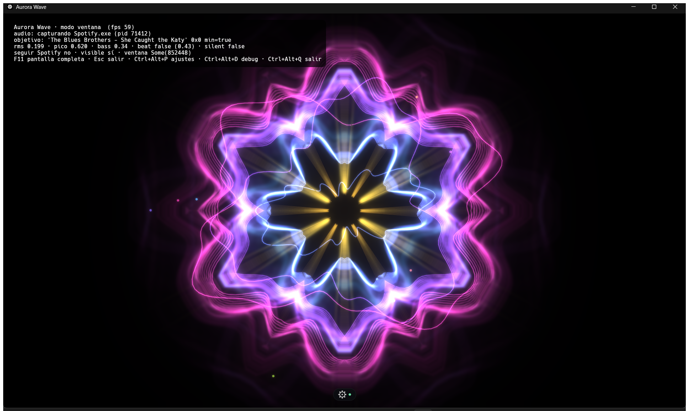
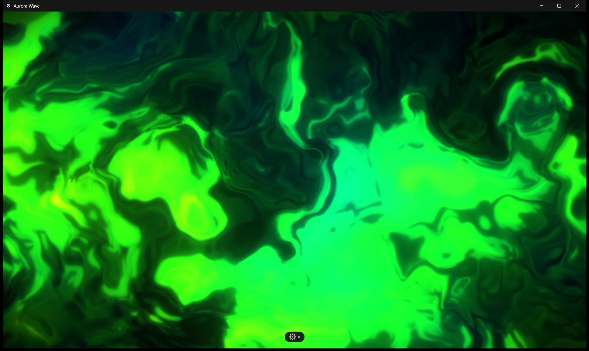
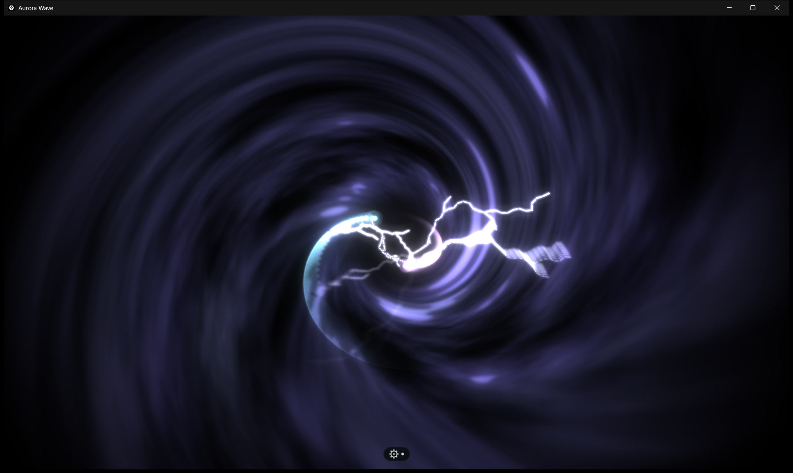
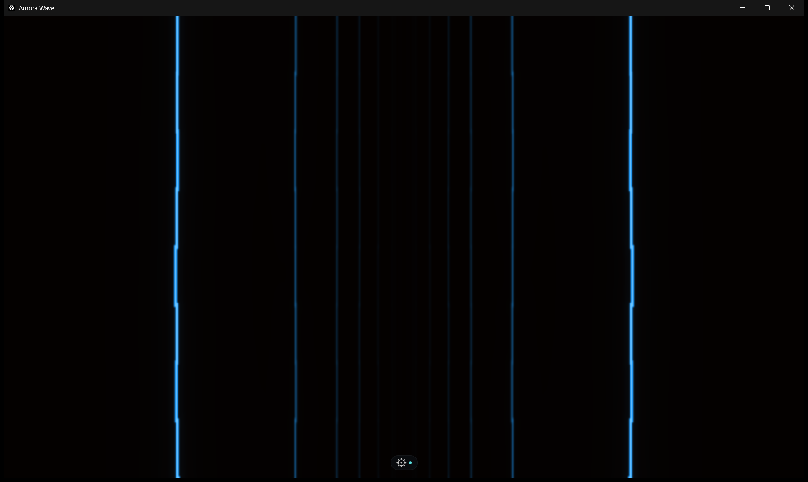
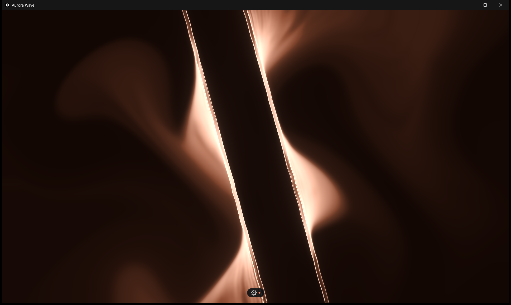
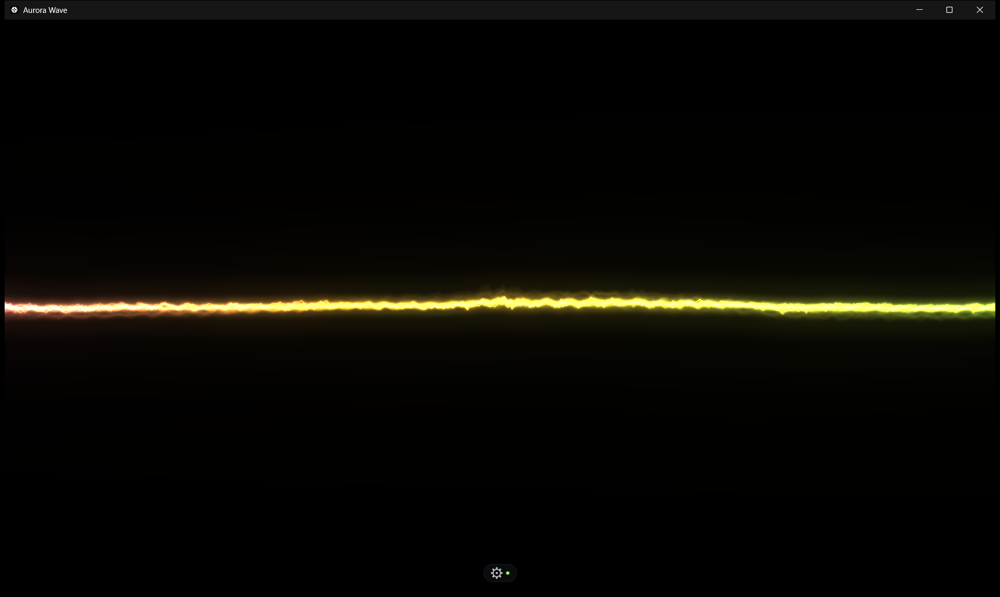
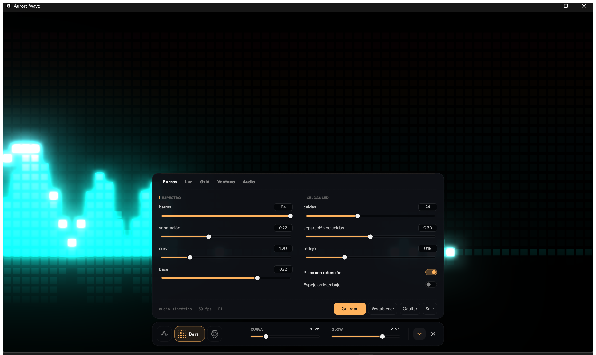

# Veeet

Visualizador de audio reactivo para Windows, escrito en Rust. Captura con WASAPI
el audio de la app que esté sonando (Spotify, el navegador…) y dibuja ocho presets sobre wgpu, con el bloom real de
UnrealBloomPass: **Wavy Form Variant #3**, **Anillo**, **Huracán** y cinco
recreaciones originales estilo Windows Media Player.

**Versión 0.9.0** · Descarga: [veeet.staytruemx.com](https://veeet.staytruemx.com)



















## Qué hace

- Abre como una **ventana normal de Windows**, con barra de título, botones estándar
  y tamaño redimensionable. Recuerda posición y tamaño.
- Captura el audio **por aplicación** con *process loopback* de WASAPI. En modo
  **Automático** (el predeterminado) sigue a la app que esté sonando: si pausas
  Spotify y sigues con YouTube en el navegador, cambia sola en ~1,5 s. También se
  puede fijar una app concreta o escuchar todo el sistema (ver
  [Fuente de audio](#fuente-de-audio)).
- Analiza el audio en tiempo real con FFT de 2048 muestras.
- Ocho presets visuales:
  - **Wavy Form #3**: la onda de Vizz, con 2 líneas de 1 px superpuestas, color HSL,
    Grid Tile y bloom exacto.
  - **Anillo**: anillos de onda concéntricos, uno por rango de frecuencia, con estela
    líquida.
  - **Huracán**: dos esferas viajan por una tormenta nebulosa y disparan rayos.
  - Recreaciones estilo Windows Media Player: **Alquimia** (Alchemy), **Ambiente**
    (Ambience), **Scope**, **Niagara** y **Windmill** (Ambience · Niagara y Windmill).
- **UnrealBloomPass real**: 5 mips, kernels personalizados de Vizz, high-pass,
  composición y mezcla aditiva.
- Panel de ajustes rediseñado con tarjetas de preset, tipografía propia y pie fijo.
- Opción **Seguir a Spotify** para acoplar la ventana normal junto a Spotify sin
  quitar la barra de título.

## Requisitos

- Windows 10/11 de 64 bits.
- Rust 1.95 o superior (solo para compilar).
- Algo sonando: Spotify, un navegador, un reproductor… cualquier app que use el
  modo compartido de Windows.

## Compilar y ejecutar

```powershell
cargo build --release
.\target\release\veeet.exe
```

Para probar sin Spotify:

```powershell
cargo run -- --fake
```

Para arrancar directamente en otro preset (`ring`, `alchemy` o `ambience`):

```powershell
$env:VEEET_PRESET = "ring"
.\target\release\veeet.exe
```

El binario de release no abre consola. Para ver el HUD de diagnóstico y los logs usa
el binario de desarrollo con `cargo run -- --debug`.

## Controles

| Atajo | Acción |
|---|---|
| `Ctrl+Alt+P` | Abrir/cerrar el dock de ajustes |
| `F11` | Entrar/salir de pantalla completa |
| `Esc` | Cierra el cajón, luego el dock y, en pantalla completa, sale de ella |
| `Ctrl+Alt+Shift+M` | Alternar ventana ↔ pantalla completa |
| `Ctrl+Alt+T` | Activar/desactivar click-through en overlay avanzado |
| `Ctrl+Alt+D` | Mostrar/ocultar el HUD de diagnóstico |
| `Ctrl+Alt+V` | Mostrar/ocultar la ventana |
| `Ctrl+Alt+Q` | Guardar la configuración y salir |

También puedes abrir el dock con la **píldora de ajustes** abajo al centro. El dock
muestra los presets y dos ajustes rápidos; la flecha abre el cajón con el resto de
ajustes por pestañas. En pantalla completa el cursor y la interfaz se ocultan después de 2.5 s de
inactividad; aparecen al mover el mouse.

## Ventana y modos

- **Ventana (predeterminado)**: ventana normal, decorada, redimensionable y sin
  “siempre encima” por defecto.
- **Seguir a Spotify**: coloca la ventana junto a Spotify (a la derecha si cabe; si no,
  a la izquierda) y la sigue al moverlo o redimensionarlo.
- **Pantalla completa**: F11. `Esc` sale y devuelve la ventana a
  su geometría anterior.
- **Modos sin bordes** (pestaña Ventana del cajón), para casos especiales:
  - **Acoplar sin bordes**: tira sin bordes pegada a Spotify.
  - **Overlay translúcido**: cubre la ventana de Spotify y permite click-through.

## Configuración

Se guarda en:

```
%APPDATA%\veeet\config.toml
```

Si no existe y hay una config de cuando la app se llamaba Aurora Wave
(`%APPDATA%\aurora-wave\config.toml`), se lee esa y se guarda en la ruta nueva.

Se crea al salir, al pulsar **Guardar** o al cerrar el dock. Solo guarda lo
global (ventana, fuente de audio y atajos) y el preset activo. Los ajustes visuales
van en cada preset (ver [Presets](#presets)):

```toml
mode = "windowed"        # windowed | fullscreen | docked | overlay
active_preset = "builtin-wavy_form3"

[window]
dock_width = 420.0
dock_gap = 0.0
dock_side = "auto"
always_on_top = false
overlay_click_through = true
hide_when_spotify_minimized = true
overlay_opacity = 0.55
target_process = "Spotify.exe"
follow_spotify = false
windowed_width = 1100.0
windowed_height = 650.0
windowed_x = 0.0
windowed_y = 0.0
ui_auto_hide = true

[audio]
process = "Spotify.exe"    # app fija en modo "app"; preferida en modo "auto"
mode = "auto"              # auto | app | device  ("process" de configs viejas = auto)

[hotkeys]
toggle_visible = "ctrl+alt+v"
cycle_mode = "ctrl+alt+shift+m"
toggle_click_through = "ctrl+alt+t"
toggle_debug = "ctrl+alt+d"
toggle_menu = "ctrl+alt+p"
quit = "ctrl+alt+q"
```

Los atajos usan el formato de `global-hotkey` (por ejemplo, `ctrl+alt+shift+m`). Si
un atajo ya está ocupado por otra aplicación, se omite y aparece un aviso en el log;
puedes cambiarlo en el archivo.

## Presets

Cada preset guarda **todos** sus ajustes: luz, color, mosaico, estela, grosor y
también la reacción al audio (ganancia, suavizado del espectro, sensibilidad a
golpes). No hay ajustes visuales globales, así que tocar un preset nunca cambia
otro.

Hay tres clases de presets, cada una en su carpeta de `%APPDATA%\veeet\presets`:

| Carpeta    | Qué guarda                                                                 |
|------------|----------------------------------------------------------------------------|
| `builtin\` | Los 8 de fábrica, solo si los cambiaste. **Restablecer** vuelve a fábrica.  |
| `user\`    | Los tuyos: se crean desde **Mis presets** eligiendo un motor, o duplicando. |
| `market\`  | Los importados (el marketplace local). Son de solo lectura: duplícalos para editarlos. |

Los cambios se guardan solos un segundo después de soltar el control.

### Compartir presets

1. En **Mis presets**, pulsa **Exportar…**: se guarda un archivo `nombre.veeet.toml`.
2. Pásalo como quieras (chat, nube, USB).
3. Quien lo recibe lo instala desde **Marketplace → Importar…**, arrastrando el archivo
   a la ventana, o copiándolo en `presets\market\` y pulsando **Recargar**.

Si el archivo trae el mismo `id` que uno instalado y un `version` mayor, lo
reemplaza; con la misma versión o una menor, no hace nada. Los archivos de más de
64 KB o que no son TOML válido se rechazan, y cada valor se limita a su rango, así
un preset nunca rompe el render.

Formato. El archivo solo guarda los ajustes que usa su motor; los que falten
toman el valor de fábrica **de ese motor**:

```toml
id = "nebula-violeta"
name = "Nébula violeta"
author = "ana"
description = "Ambiente lento con tinte violeta"
tags = ["chill", "violeta"]
version = 1

[params]
preset = "ambience"        # motor: wavy_form3 | wave_ring | alchemy | ambience | scope
                           # | hurricane | niagara | windmill
ambience_speed = 0.4
ambience_scale = 2.0
ambience_brightness = 1.3
ambience_glow = 1.1
exposure = 1.1

# Reacción al audio
gain = 1.0
spectrum_smoothing = 0.8
beat_sensitivity = 0.5
smoothing = 0.95
freq_influence = 1.0

# Colores del motor: "original" o un degradado propio de 3 colores
color_mode = "custom"
color_a = [40, 20, 120]
color_b = [200, 60, 200]
color_c = [255, 200, 120]
color_cycle = 0.5          # velocidad con la que recorre la paleta

# Encuadre
scene_scale = 1.0          # 2 = el doble, 0.5 = la mitad
offset_x = 0.0             # -0.5..0.5
offset_y = 0.0

# Luz
bloom_threshold = 0.2
bloom_radius = 0.3
contrast = 1.0
vignette = 0.3

# Color
hue_shift = 0.75           # vueltas de tono (0..1)
saturation = 1.2
tint = [170, 120, 255]
tint_amount = 0.35
background = [6, 2, 14]
mirror_x = false
mirror_y = false
time_scale = 0.8           # 0 congela, 2 al doble

# Mosaico
grid_tile = false
```

Ajustes propios de cada motor (además de los comunes de arriba):

| Motor     | Ajustes |
|-----------|---------|
| Onda      | `sensitivity`, `glow`, `line_width`, `line_count`, `line_spacing`, `line_variation`, `variation_speed`, `camera_z`, `wave_width` |
| Anillo    | `sensitivity`, `fx_glow`, `line_width`, `ring_radius` (hasta 1.5), `ring_inner`, `ring_amplitude`, `ring_bands` (1–16), `ring_rotation` (negativo gira al revés), `ring_trail`, `ring_flow`, `ring_steps` |
| Alquimia  | `alchemy_trail`, `alchemy_speed`, `alchemy_complexity` (1–12), `alchemy_kaleido`, `alchemy_glow`, `alchemy_size`, `alchemy_particles`, `alchemy_star`, `alchemy_mode_time`, `alchemy_motion` |
| Ambiente  | `ambience_speed`, `ambience_scale`, `ambience_glow`, `ambience_brightness` |
| Trazo     | `sensitivity`, `fx_glow`, `fx_trail`, `line_width`, `scope_height`, `scope_expand`, `scope_blur` |
| Huracán   | `fx_glow`, `fx_trail`, `hurricane_eye`, `hurricane_sphere_size`, `hurricane_sphere_speed`, `hurricane_bolts` (0 = sin rayos), `hurricane_swirl` |
| Niagara   | `sensitivity`, `fx_glow`, `fx_trail`, `niagara_speed`, `niagara_emit`, `niagara_squeeze`, `niagara_steps`, `niagara_line`, `niagara_continuous` |
| Molino    | `sensitivity`, `fx_glow`, `fx_trail`, `windmill_speed` (negativo gira al revés), `windmill_width` (junta o separa las líneas que giran), `windmill_edge_lines`, `windmill_edge_gap`, `windmill_blur`, `windmill_amplitude` |

Al actualizar desde una versión anterior, la sección `[visual]` de `config.toml`
se copia a cada uno de los 8 presets de fábrica.

### Modo aleatorio

El dado del menú de escenas (o la pestaña **Aleatorio**) va cambiando de preset
solo. Cuando se cumple el intervalo espera al próximo golpe (como mucho 4 s), funde
a negro, cambia y vuelve a encender. En la pestaña se eligen las escenas que entran:
todas (también las que crees después) o una lista. Es un ajuste global, en
`config.toml`:

```toml
[shuffle]
enabled = true
interval_secs = 45.0
wait_for_beat = true
fade_secs = 0.5
all = false
presets = ["builtin-alchemy", "builtin-wave_ring", "nebula-violeta"]
```

## Diseño del menú

El menú es un **dock inferior** al estilo de la barra de transporte de un DAW,
documentado en [`docs/menu-design.md`](docs/menu-design.md). Usa las fuentes
**Outfit**, **Instrument Sans** y **Geist Mono**; las licencias OFL están en
`assets/fonts/`.

- **Handle**: una píldora discreta abajo al centro abre el dock.
- **Dock**:
  - Un botón con el icono del preset activo abre un **submenú** con todos los
    presets en rejilla, solo iconos; el tooltip de cada uno es una palabra.
  - Hasta **cuatro ajustes rápidos** (los que quepan): el principal del preset, glow,
    uno secundario del preset y exposición.
  - **Deshacer**, la flecha del cajón y cerrar.
- **Cajón**: pestañas Preset · Luz · Grid · Ventana · Audio, en dos columnas cuando
  hay ancho. Pie con Guardar, Restablecer, Deshacer, Ocultar y Salir.
  - **Restablecer** solo devuelve a sus valores por defecto los ajustes de la
    pestaña abierta.
  - **Deshacer** revierte el último cambio (un arrastre completo de slider cuenta
    como uno; se recuerdan 50). No toca la posición ni el tamaño de la ventana.
- Acento por preset: cian (Wavy Form #3), ámbar (Anillo), verde (Alquimia), violeta
  (Ambiente), lima (Scope), blanco hielo (Huracán), turquesa (Niagara) y coral
  (Windmill).

## Algoritmo de Vizz #3

Estos son los valores y fórmulas exactas extraídos del preset
`config-1742751498260-29` y del renderer WebGL de vizz.fm.

### Analizador

```
fftSize = 2048
frequencyBinCount = 1024
minDecibels = -110
maxDecibels = -20
smoothingTimeConstant = 0.8
```

La onda usa 1024 puntos. Cada muestra de tiempo se cuantiza a 8 bits y se escala:

```text
t = (byte_tiempo / 128 - 1) * 0.7
n = n_anterior + (t - n_anterior) * (1 - 0.95^(dt * 120))
```

El espectro se espeja desde el centro hacia los bordes:

```text
a = |i - 512|
freq = espectro[a] / 255 * freq_influence
d = n * (1 + freq)
```

La posición vertical aplica el refuerzo de bordes:

```text
edge = 1 + (1 - 2 * |i / 1024 - 0.5|)^2
y = d * sensitivity * edge
```

### Color

```text
v = |d|
g = 1.4 * freq

hue   = 1 - min((v + g) * 1.2, 1)
sat   = min(0.85 + 0.15 * g, 1)
light = min(0.4 + 0.4 * max(v, g), 0.8)

color = HSL(hue, sat, light) * 1.3
```

No existe ningún `mix` a blanco. El resaltado casi blanco de los picos más altos es
consecuencia de la *lightness* 0.8, el multiplicador 1.3 y el bloom.

### Geometría

- Cámara perspectiva de 50°, Z = 1.564709 y grupo con `scale.x = R`, `scale.y = 2`.
  La app reproduce esa proyección en 2D.
- 2 líneas de 1 px, separadas 0.002 en Z. En 2D se dibujan superpuestas; el resultado
  visible es una sola línea.
- **Grid Tile**: 1 columna × 3 filas autoradas, `overlap = 0.34`, `opacity = 0.10`.
  Las filas efectivas se adaptan a la altura de la ventana, igual que en Vizz.

### UnrealBloomPass

El bloom es el `UnrealBloomPass` real, no una aproximación:

1. **High-pass** con umbral 0.2, `smoothWidth = 0.01` y luminancia
   `0.2126 R + 0.7152 G + 0.0722 B`.
2. **5 mips** a mitad, cuarto, octavo, dieciseisavo y treintaidosavo de resolución.
3. **Kernels personalizados de Vizz**: radios `[3, 5, 7, 9, 11]` y coeficientes
   `0.39894 * exp(-0.5*i²/R²) / R`, normalizados en el shader.
4. **Composición** con `strength`, `radius = 0.3` y factores
   `[1, 0.8, 0.6, 0.4, 0.2]`.
5. **Mezcla aditiva** sobre la escena, equivalente al blend material de Vizz.
6. **Grid Tile** se aplica después del bloom y antes del recorte final.

## Bandas del espectro

El analizador entrega 64 bandas logarítmicas de 30 Hz a 16 kHz. Alquimia y Ambiente
las agrupan en graves, medios y agudos. El movimiento sigue el modelo de la onda de
Vizz, con la autosens de [cava](https://github.com/karlstav/cava) encima:

1. **Nivel**: potencia media de cada banda en dB (−82 a −37 dB), con una
   compensación de **+4.5 dB/oct** para que los agudos no queden apagados.
2. **Suavizado de Vizz**: exponencial simétrico, `1 − smoothing^(dt·120)`. Usa el
   mismo slider *motion smoothing* que la onda.
3. **Piso dinámico**: se resta el 75 % de la media de las bandas (seguida en ~2 s).
4. **Autosens de cava**: una ganancia global que baja un 2 % por frame cuando alguna
   banda pasa de 0.95 y sube un 0.1 % por frame cuando no.

El **beat** se detecta con spectral flux de graves (30–150 Hz) y medios-altos
(1.5–5 kHz), con un umbral adaptativo.

## Preset Anillo

Anillos de onda concéntricos, uno por rango de frecuencia, con estela líquida.

- `ring_bands` anillos (5 por defecto, de 3 a 8): graves al centro, agudos afuera.
  Cada anillo toma la energía de su rango; los graves además hacen respirar su radio.
- La deformación sale de la forma de onda (ida y vuelta, sin costura). Cada anillo
  empieza en otra zona de la onda y gira en sentido alterno.
- Color por banda: magenta en graves y cian en agudos.
- **Estela líquida**: feedback suave (zoom leve, remolino y ondulación), como tinta
  en agua. `ring_trail` (0.88) controla cuánto dura.
- Radio (`ring_radius`) y rotación (`ring_rotation`). Glow con `fx_glow`.
- `VEEET_PRESET=ring` arranca directo en este preset.

## Preset Alquimia

Recreación **original** inspirada en Alchemy de Windows Media Player. No usa código
ni recursos de Microsoft.

- **Feedback en GPU** (`render/alchemy.wgsl`): cada frame, la imagen anterior se
  transforma (zoom, rotación, remolino, ondulación o caleidoscopio). Luego se
  difumina con 5 taps, se apaga según la **estela** (`alchemy_trail`) y rota de tono.
  Encima se suman los trazos nuevos. El resultado reemplaza la escena antes del bloom.
- **Ciclo de modos**: remolino, zoom hacia afuera, caleidoscopio de 6 segmentos
  (`alchemy_kaleido`), smear ondulante y estrella. Cambia cada 10–14 s, o en un beat
  fuerte tras 6 s, con un crossfade de 1.5 s.
- **Trazos**: `alchemy_complexity` curvas tipo rosa/Lissajous moduladas por graves,
  medios y agudos, una estrella de rayos en cada beat y partículas en órbita.
- **Audio**: los graves y el beat empujan el zoom, los medios la rotación y los
  agudos el giro de tono. En silencio la imagen se apaga a negro.
- `alchemy_speed` controla la velocidad y `alchemy_glow` (0.6) el glow propio.
- `VEEET_PRESET=alchemy` arranca directo en este preset.

## Preset Ambiente

Recreación **original** inspirada en Ambience de Windows Media Player. No usa código
ni recursos de Microsoft.

- **Shader de pantalla completa** (`render/ambience.wgsl`): ruido fbm de 4 octavas con
  doble *domain warping* (técnica de Íñigo Quílez) y una paleta coseno cuyo tono
  deriva con el tiempo. El hash es entero (estilo PCG), así no aparecen bloques con
  coordenadas grandes.
- **Audio**, suavizado a ~250 ms para que las nubes respiren y no tiemblen:
  - los graves aumentan la deformación;
  - los agudos agregan detalle y aceleran el cambio de tono;
  - la energía acelera el flujo y sube el brillo.
- **Pulso en el beat**: un golpe con ataque instantáneo que decae en ~180 ms acerca
  la imagen (12 %), sube el brillo y deforma un poco las nubes. No cambia la
  velocidad del flujo ni el tono: es un latido, no un cambio de escena.
- `ambience_speed` (0.6) controla el flujo, `ambience_scale` (1.4) el tamaño de las
  nubes y `ambience_glow` (0.8) el glow propio.
- `VEEET_PRESET=ambience` arranca directo en este preset.

## Preset Scope

Recreación **original** inspirada en Scope (Bars and Waves) de Windows Media Player.
Osciloscopio de la forma de onda a lo ancho de la pantalla; con el feedback de
Alquimia, las copias anteriores se abren hacia afuera y se apagan (`fx_trail`).
`VEEET_PRESET=scope`.

## Preset Huracán

Dos esferas viajan por un huracán nebuloso y disparan rayos.

- **Nebulosa** (`ambience.wgsl`, modo 1): nubes fbm en espiral logarítmica alrededor
  de un ojo oscuro con pared brillante. La coordenada radial `ln(r) − t` hace que las
  nubes fluyan hacia afuera, como si la cámara avanzara hacia el ojo; el beat acelera
  ese túnel y da un destello violeta dentro de la nube. Se suma a la escena después
  del feedback, así no se acumula en las estelas.
- **Esferas viajeras**: cada una tiene su propio tiempo, que el beat acelera de golpe.
  Recorren trayectorias libres: entran y salen del ojo, cruzan la nube y derivan en
  curvas tipo ocho. Una profundidad variable cambia su tamaño y brillo (vienen hacia
  la cámara y se alejan). Dejan una estela de cometa de 48 posiciones.
- **Rayos ramificados** en cada beat (o con energía alta): entre las esferas y hacia
  la tormenta. Duran 0.22 s.
- `VEEET_PRESET=hurricane`.

## Preset Niagara

Recreación **original** inspirada en Ambience · Niagara de Windows Media Player.
Se midió cuadro a cuadro sobre la demo de
[wmp-legacy-visualizers](https://wmp.ryancircelli.com), sin usar su código.

- **Modo paleta**: el feedback guarda solo la *intensidad* (en el alfa) y la
  colorea con una paleta `fondo → medio → claro`, como las visualizaciones
  Ambience. Paleta en contraste: fondo oscuro de un tono y líneas del tono opuesto
  con núcleo casi blanco; el tono rota muy lento.
- En cada **beat** nace una línea gruesa a cada lado, en espejo, a 40.6 % del ancho
  desde el centro (valor medido). Su forma es la forma de onda en **escalones**
  (tramos verticales unidos por saltos horizontales).
- Cada cuadro el feedback **contrae la imagen en horizontal hacia el centro**
  (×0.93 por cuadro a 30 fps, medido), así las líneas viajan hacia adentro, se
  juntan y se apagan (decaimiento ~0.95 por cuadro) sin llegar a tocarse.
- **Con el beat**: la contracción se acelera en el golpe y casi se detiene entre
  golpes (las líneas avanzan a pulsos), y una ondulación horizontal que se apaga
  con el golpe hace vibrar las líneas.
- `niagara_speed` cambia la velocidad de la contracción; `fx_trail`, la estela.
- `VEEET_PRESET=niagara` (las configs con `lightning` cargan como Niagara).

## Preset Windmill

Recreación **original** inspirada en Ambience · Windmill de Windows Media Player,
medida sobre la misma demo.

- Una **franja** de ~19 % del alto cruza el centro y gira despacio en sentido
  antihorario (~8 °/s, medido; el beat la acelera, `windmill_speed`). La franja
  **borra** la intensidad a su paso y queda del color de fondo.
- Sus **bordes** inyectan la forma de onda en líneas dobles. Con el beat la franja
  **respira** (se abre hasta 45 %) y la amplitud de la onda se triplica.
- La ondulación del feedback sube con el golpe, así los bordes de la nube se rompen
  en jirones y remolinos en vez de quedar lisos al separarse de la franja.
- El resto se difunde (blur y ondulación) y casi no decae: forma una **nube** de
  manchas en una paleta de un solo tono (fondo oscuro → medio → casi blanco).
- `VEEET_PRESET=windmill`.

## Fuente de audio

```
app que suena → WASAPI process loopback → mono 48 kHz → FFT/waveform → wgpu
```

Se elige en el menú, pestaña **Audio**:

- **Automático** (predeterminado): cada 400 ms se leen las sesiones de audio de
  todas las salidas activas, con su nivel de pico. Veeet se queda con la app actual
  mientras suene. Si lleva 1,2 s en silencio y otra app suena de forma sostenida
  (350 ms), cambia a esa. Si suenan varias, gana `audio.process` (Spotify).
- **Una app concreta**: la lista *Apps con audio* muestra cada app con sesión de
  audio, un punto encendido si está sonando y el título de su ventana (en un
  navegador, la pestaña activa). Al pulsar una fila, Veeet escucha solo esa app
  aunque otras suenen.
- **Todo el sistema**: loopback del dispositivo de salida predeterminado, con todo
  mezclado.

Detalles:

- Las sesiones de los subprocesos (Chrome, Edge y Firefox reproducen desde un
  proceso hijo) se agrupan en el proceso raíz del mismo ejecutable. El loopback
  se abre sobre ese árbol completo.
- **FxSound, Voicemeeter y similares** reproducen el audio de las demás apps, así
  que siempre "suenan". En automático solo se eligen si no suena ninguna otra app.
  Como se miran todas las salidas, también se encuentra la música que va a un
  dispositivo virtual.
- Si la app capturada se cierra, la captura se reinicia y vuelve a elegir.
- Variables de entorno: `VEEET_AUDIO_MODE=auto|app|device` y
  `VEEET_AUDIO_PROCESS=chrome.exe` (fija esa app y pone el modo en `app`).

Limitaciones:

- El audio en modo exclusivo no se puede capturar.
- El visualizador no controla los reproductores: solo escucha.

## Sobre la transparencia del overlay avanzado

Windows no está entregando el canal alfa del swapchain de wgpu en esta configuración;
por eso el overlay avanzado no usa transparencia por píxel. En su lugar se aplica
`WS_EX_LAYERED` con una opacidad uniforme (`overlay_opacity`). El resultado es un
cristal negro translúcido: Spotify se ve atenuado detrás de la onda, el click-through
funciona y el glow se mantiene. La transparencia real por píxel queda como trabajo
futuro (DirectComposition o un backend de composición dedicado).

## Herramientas de desarrollo

```powershell
# Tono de prueba por WASAPI en el dispositivo predeterminado
cargo run --example play_tone

# Diagnóstico de captura loopback del dispositivo (12 segundos)
cargo run --example audio_probe
```

Variables de entorno útiles:

- `VEEET_PRESET=ring|alchemy|ambience|scope|hurricane|niagara|windmill` arranca
  en ese preset. También acepta el `id` o el nombre de un preset propio o importado.
- `VEEET_AUDIO_PROCESS=chrome.exe` captura el audio de Chrome (útil para probar
  archivos de audio).
- `VEEET_MODE=fullscreen` arranca en pantalla completa.
- `VEEET_TARGET=notepad.exe` usa otra ventana como referencia de acople.

El prefijo anterior `AURORA_` sigue funcionando.

## Estructura

```
src/
  app.rs              ventana, modos, hotkeys y efectos del menú
  config.rs           TOML, valores por defecto y límites de cada ajuste
  preset.rs           presets por archivo: fábrica, propios e importados
  shuffle.rs          modo aleatorio: intervalo, espera al golpe y fundido
  audio/
    capture.rs        hilo WASAPI y ring buffer
    analysis.rs       FFT 2048, Blackman, onda y espectro de Vizz, beats
    fake.rs           audio sintético para desarrollo
  ui/
    mod.rs            pestañas y acciones del menú
    dock.rs           handle, dock y cajón de ajustes
    widgets.rs        sliders, interruptores, chips, pestañas e iconos
    theme.rs          tokens: superficies, tinta, acentos por preset y fuentes
  render/
    wave.rs           pipeline wgpu, onda, Alquimia, Ambiente, feedback, bloom y Grid Tile
    wave/fx.rs        Anillo, Scope, Huracán, Niagara y Windmill (geometría + feedback)
    palette.rs        tablas de color de Alquimia
    ambience.rs       audio suavizado y flujo de Ambiente
    ambience.wgsl     nubes de Ambiente y nebulosa del Huracán (fbm + domain warping)
    alchemy.rs        ciclo de modos y parámetros del feedback de Alquimia
    alchemy.wgsl      feedback compartido (zoom, remolino, caleidoscopio, smear, blur,
                      color de fondo, borrador, contracción por eje y modo paleta)
    wave.wgsl         línea y shader de vértices
    highpass.wgsl     high-pass del bloom
    blur.wgsl         blur separable con kernels de Vizz
    bloom.wgsl        composición de los 5 mips
    copy.wgsl         mezcla aditiva del bloom
    final.wgsl        Grid Tile, exposición y salida
  platform/
    mod.rs            ventanas Win32, docking, estilos y DWM
  hotkeys.rs
  main.rs
assets/
  fonts/              Outfit, Instrument Sans y Geist Mono (OFL)
examples/
  play_tone.rs        reproductor de prueba por WASAPI
  audio_probe.rs      sonda de captura loopback
docs/
  menu-design.md      dirección de diseño del dock
  dock.png            dock con el cajón abierto
```

## Licencia

Copyright (C) 2026 Kabir.

Veeet es software libre bajo la **GNU General Public License v3.0 o
posterior** (`GPL-3.0-or-later`); el texto completo está en [`LICENSE`](LICENSE).

- Puedes usar, estudiar, modificar y redistribuir el código.
- Si distribuyes una versión modificada o un programa que lo incluya, debe
  publicarse también bajo GPL-3.0 con su código fuente, conservando este aviso de
  copyright (el crédito al autor).

Las fuentes incluidas conservan sus licencias OFL en `assets/fonts/`. Los presets
inspirados en Windows Media Player son recreaciones originales: no incluyen código
ni recursos de Microsoft.

## Créditos

Hecho por [Stay True](https://staytruemx.com).
